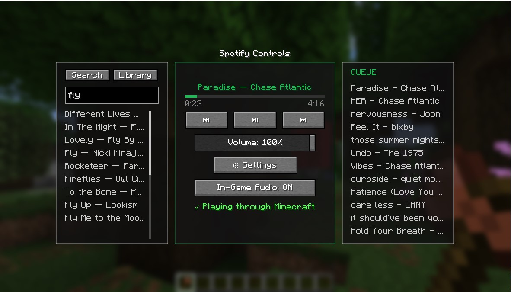
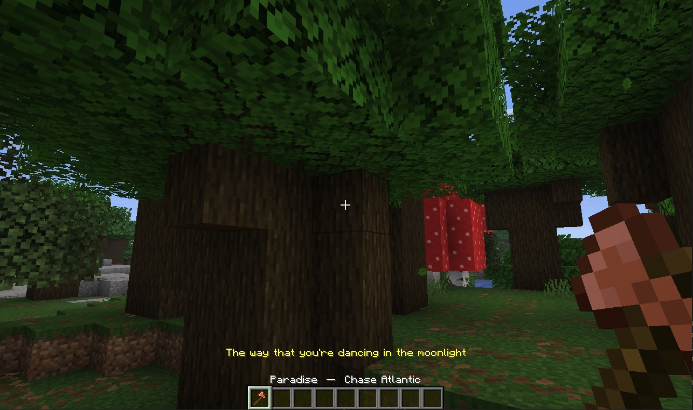

# SpotyMC

Listen to Spotify without leaving Minecraft.

SpotyMC is a Fabric mod that turns your game into a Spotify controller and player: control playback, browse your queue, view lyrics, and keep tabs on what is playing from inside the HUD.

<p align="center">
  
  
</p>

## Why use SpotyMC?

- Play and control Spotify from inside Minecraft with a native in-game UI
- Browse queue, search results, and track metadata without alt-tabbing
- View synced lyrics with customizable color, size, and format
- Use hotkeys for quick controls while playing
- Set everything up through an in-game guided flow

## Features

- **Spotify Connect playback** — SpotyMC appears as a Spotify Connect device, powered by [librespot](https://github.com/librespot-org/librespot)
- **In-game HUD** — player controls, track info, and a progress bar rendered directly in your Minecraft UI
- **Lyrics display** — synced lyrics with customizable color, font size, and format
- **Queue & search** — browse and click through your queue and search results without leaving the game
- **Hotkeys** — control playback with `Right Ctrl` + arrow keys, including volume ramping
- **Guided setup** — built-in installer handles the librespot backend and Spotify authentication with clear on-screen instructions

## Requirements

- Minecraft with [Fabric Loader](https://fabricmc.net/)
- [Fabric API](https://modrinth.com/mod/fabric-api)
- A Spotify account (Premium is required for playback, per Spotify's own restrictions)
- Your own Spotify Developer Client ID (set up is guided in-app)

## Quick setup

1. Install [Fabric Loader](https://fabricmc.net/) and [Fabric API](https://modrinth.com/mod/fabric-api) for your Minecraft version.
2. Download and install SpotyMC.
3. Launch Minecraft and open the SpotyMC settings screen.
4. Follow the in-game instructions to create a Spotify Developer app and enter your Client ID.
5. Authenticate with Spotify, and the mod will handle the rest, including installing the librespot backend on first run.

## Building from source

For development setup, see the [Fabric Documentation page](https://fabricmc.net/wiki/) related to the IDE you are using.

```bash
./gradlew build
```

## Credits

SpotyMC bundles precompiled binaries of [librespot](https://github.com/librespot-org/librespot) (MIT license) to handle Spotify Connect authentication and audio streaming. librespot's code is unmodified and runs as a backend process; all HUD, lyrics, queue, and UI features are built independently by SpotyMC.

## License

This project is licensed under the MIT License — see the [LICENSE](LICENSE) file for details.

## Disclaimer

SpotyMC is an independent project and is not affiliated with, endorsed by, or sponsored by Spotify AB.
